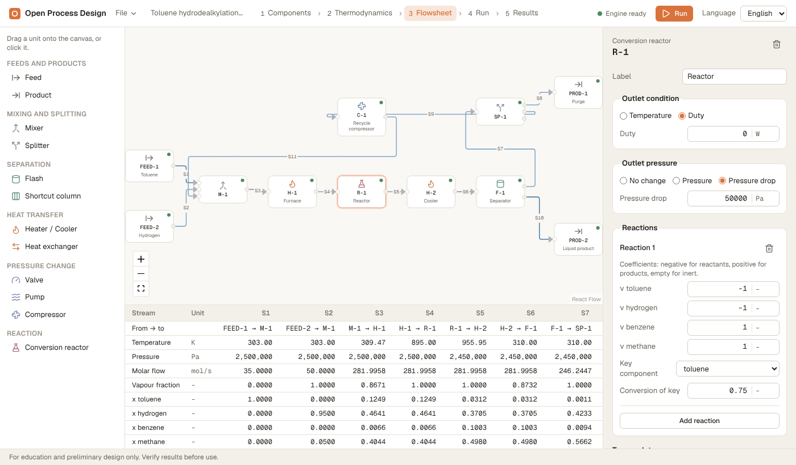
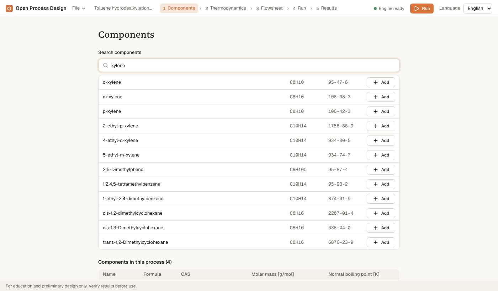
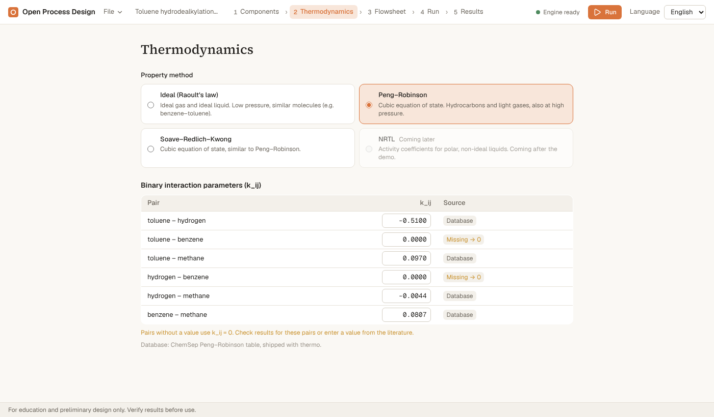
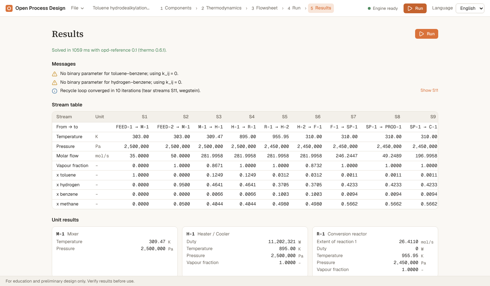

# Open Process Design — Simulator

An open-source, web-based, general-purpose chemical process simulator.
Open a link, build any flowsheet, run it, read the results — no installation, no license fee.

**Live demo: https://open-processdesign.github.io/simulator/** — runs entirely in your browser
(the first visit downloads about 70 MB for the calculation engine; later visits use the browser cache).

> **Status:** demo (M1). Next: rigorous units (M2) and a validated v0.1 release by March 2027 (M3).
> Results are for **education and preliminary design only**. Verify them before use.



## Try it

1. Open the demo. Choose **File → Examples** (flash drum, benzene–toluene column, simplified HDA recycle loop), or start empty.
2. **Components:** search by name, formula or CAS number (1347 components from the MIT-licensed `chemicals` database).
3. **Thermodynamics:** Ideal (Raoult), Peng–Robinson or SRK; see where each k_ij comes from.
4. **Flowsheet:** drag units from the palette, connect an outlet (right) to an inlet (left), set specs in the side panel. Dots: grey = not checked, hollow green = inputs complete, amber = missing input, red = error, green = solved.
5. **Run**, then read the stream table, unit results and messages; click a message to jump to the unit or stream.
6. **File → Save as file** keeps the process as an `.opd.json` file you can open again or share.

Units: feed, product, mixer, splitter, flash, heater/cooler, heat exchanger, valve, pump, compressor,
conversion reactor, CSTR, PFR, equilibrium reactor, shortcut column (Fenske–Underwood–Gilliland), rigorous distillation
column. Property methods: Ideal, Peng–Robinson, SRK, NRTL, UNIQUAC. Recycle loops converge automatically (Wegstein).
Unit sets SI / Metric / English; CSV export. Guides: [English](docs/USER_GUIDE.md) · [Türkçe](docs/USER_GUIDE.tr.md).
How each model is checked: [docs/VALIDATION.md](docs/VALIDATION.md).

| Components | Thermodynamics | Results |
|---|---|---|
|  |  |  |

## Why

- Commercial simulators (Aspen, CHEMCAD) are expensive; many universities cannot license them.
- Free tools are powerful but hard to learn.
- Students graduate without enough hands-on simulation practice.

## What it is

- **Web-based:** runs in the browser, shareable by link.
- **General-purpose:** any process, not a fixed set of examples (HDA is only a validation case).
- **Simple workflow:** Components → Thermodynamics → Flowsheet → Run → Results.
- **Familiar to CHEMCAD users:** unit palette, side-panel settings, stream tables.
- **Clear errors:** tells you *what* is missing *where*, instead of "convergence failed".
- **Bilingual:** English (default), Turkish.

## Architecture (short)

```
Browser UI (React) ──► Web Worker ──► Python engine layer on Pyodide ──► Engine adapter ──► reference engine (MIT thermo)
        │                                                                     └──► DWSIM service (after the demo)
        └── OPD flowsheet format (engine-independent JSON, schema/flowsheet.schema.json)
```

For the demo there is no server: the engine layer (`engine/opd_engine`) runs in the browser on Pyodide
(DECISIONS.md D011, D014). The UI and data never depend on a specific engine; DWSIM joins later as a separate
service behind the same adapter interface, and engines are replaced module by module ("strangler fig").
See [docs/ARCHITECTURE.md](docs/ARCHITECTURE.md) and [DECISIONS.md](DECISIONS.md).

## Develop

```bash
# engine (Python 3.12+)
cd engine && pip install -e ".[dev,reference]" && pytest

# web app (Node 22)
cd web && npm ci && npm run dev    # http://localhost:5173
npm test                           # unit tests
```

Every push to `main` is tested and published to GitHub Pages (`.github/workflows/pages.yml`).

DWSIM is used as a separate service and credited as such; this project does not use the DWSIM name or logo for its own product.

## Repository map

| Path | Purpose |
|---|---|
| `ROADMAP.md` | Phases and milestones |
| `TASKS.md` | Task list (agents pick from here) |
| `PROGRESS.md` | Log of every work session |
| `DECISIONS.md` | Decisions and their reasons |
| `QUESTIONS.md` | Open questions for the maintainer |
| `AGENTS.md` | Rules for all AI agents (incl. the lock rule) |
| `docs/` | Architecture and design system |
| `schema/` | OPD flowsheet JSON Schema |
| `examples/` | Example flowsheets |
| `design/` | Design tokens |
| `engine/` | Engine layer (Python): OPD models, adapters, reference engine, recycle solver |
| `web/` | Web app (React, TypeScript, React Flow); runs the engine in a Web Worker |

## Contributing

See [CONTRIBUTING.md](CONTRIBUTING.md) and the [code of conduct](CODE_OF_CONDUCT.md).

You do not need to code to help: validate results, build process templates, collect literature
parameters, translate, report bugs. Code contributions go through pull requests; `main` is protected
and nothing merges without review and passing tests.

## License

Code: [GNU GPL v3](LICENSE). Data contributions: open data license (CC BY 4.0, planned).
